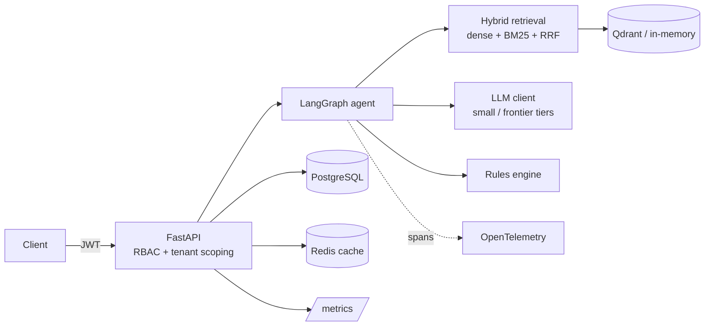

# DocuMind AI

[](https://github.com/lalithsagarkondapalli/documind-ai/actions/workflows/ci.yml)

Multi-agent RAG service for reviewing contracts and regulatory documents. It answers questions with citations that are
**verified against the retrieved text**, flags clauses against a configurable rulebook, and routes risky findings to a
human reviewer with a full audit trail. Built with FastAPI, LangGraph, Qdrant, PostgreSQL and Redis.

> **Portfolio project.** The status table below is deliberately specific about what is tested, what is only authored,
> and what has never been run. Please read it before relying on any claim here.

## Status

| Area | Status |
|---|---|
| API, JWT auth + RBAC, tenant isolation, ingestion (txt/PDF), hybrid retrieval, LangGraph agent, citation validation, review queue, audit log, caching, Prometheus metrics | **Implemented and tested.** 73 automated tests, plus a live run with 3 uvicorn worker processes |
| Multi-replica correctness (database as source of truth, per-replica index sync) | **Implemented and tested** with two app instances over one database. Found and fixed during development (see [architecture](docs/architecture.md)) |
| Evaluation framework and CI regression gate | **Implemented and run.** Results below |
| Dockerfile, Kubernetes manifests, Terraform (AWS), GitHub Actions | **Verified in CI, never deployed.** CI builds and boots the image, runs the integration tests on PostgreSQL, validates Terraform and the manifests. No `terraform apply`, no cluster, deploy job never run |
| LLM | Default provider is a **deterministic mock** (extractive, not a language model). An Anthropic provider is implemented but has not been run against the real API |
| Embeddings | A **local lexical** hashed bag-of-words embedder: no semantic understanding |

**What is verified, and how.** On every push, GitHub Actions runs (all passing on `main`, see the badge): lint; the full
test suite; the 27 integration tests against a **PostgreSQL service container**; the evaluation gate;
`terraform fmt / init / validate`; the Kubernetes manifest validator; and a **Docker build whose container is booted and
probed** at `/health` and `/ready`. The first CI run caught a real bug (the non-root container could not create its
default SQLite file); it is fixed and guarded by a test.

**Never run:** `terraform plan` / `apply` (no AWS account was used), the Kubernetes manifests against a real cluster, the
deploy job (skipped unless `DEPLOY_ENABLED=true`), the `docker-compose` stack, a real Redis or Qdrant server (Redis is
tested against `fakeredis`, Qdrant in embedded mode), and the Anthropic provider against the real API.

## Architecture



`retrieve → synthesize → validate_citations → score_risk → (needs review?) → human_review → finalize`.
Full design, request flow, multi-replica reasoning and trade-offs: [docs/architecture.md](docs/architecture.md).

## Quick start

```bash
pip install -r requirements-dev.txt
pytest                                   # 73 tests
JWT_SECRET=dev-secret uvicorn app.main:app --reload
```

Full stack (API, PostgreSQL, Redis, Qdrant, Prometheus, Grafana, OpenTelemetry collector):

```bash
cp .env.example .env     # set JWT_SECRET
docker compose up --build
```

Local demo users (only when `ENVIRONMENT != production`), password `documind-demo`:
`admin`, `reviewer`, `viewer` (org *acme*) and `globex-admin` (org *globex*, for testing tenant isolation).

```bash
B=http://127.0.0.1:8000
TOKEN=$(curl -s -X POST $B/v1/auth/token -d "username=reviewer&password=documind-demo" | jq -r .access_token)
DOC=$(curl -s -X POST $B/v1/documents -H "Authorization: Bearer $TOKEN" -F file=@contract.pdf | jq -r .id)
curl -s -X POST $B/v1/query -H "Authorization: Bearer $TOKEN" -H "Content-Type: application/json" \
     -d "{\"question\":\"What is the indemnification liability cap?\",\"document_id\":\"$DOC\"}" | jq
curl -s $B/v1/reviews/queue -H "Authorization: Bearer $TOKEN" | jq        # high-risk findings land here
```

## Evaluation

Every number comes from `reports/metrics.json`, produced by `make eval` (`tests/evaluation/`). Retrieval and
citation metrics are deterministic and reproduce exactly; timings vary by machine.

**Read these caveats first.** The corpus is **synthetic**: 60 documents,
542 chunks, 180 questions generated from templates, so ground-truth
answers are known. It is not real contracts. The embedder is lexical. The LLM is a mock.
Results show the system works end to end; they are **not** a claim about accuracy on real documents.

**Retrieval, k=5, document-scoped** (a reviewer asking about the open document):

| Method | Recall@5 | Precision@5 | MRR | NDCG@5 |
|---|---|---|---|---|
| Dense only | 90.0% | 18.0% | 0.438 | 0.557 |
| BM25 only | 93.3% | 18.7% | 0.466 | 0.587 |
| Hybrid (RRF) | 92.2% | 18.4% | 0.450 | 0.572 |

* A random top-5 would score about **55.4%** Recall@5, since documents average 9.0 chunks. That is
  the baseline these numbers should be read against.
* **BM25 alone slightly beats the hybrid here.** The "dense" embedder is itself lexical, so fusing it with BM25 adds
  almost nothing. Hybrid retrieval is the right design for a real semantic embedder; this benchmark does not show it
  helping, and I am not claiming it does.
* **Corpus-wide** search (no document scope) is near zero for every method (hybrid Recall@5 2.2%)
  because the lexical embedder cannot discriminate across 60 similar documents. This is why the API is
  document-scoped by default.

**Answer quality and safety** (100 sampled questions; 9.0% of answers were
deliberately made fabricated so the detector could be scored):

| Metric | Value | Notes |
|---|---|---|
| Citation validity rate | 91.0% | **Equals 1 minus the injected fabrication rate, by construction**: the mock answer generator always cites a retrieved chunk except on the deliberately fabricated answers (9.0%). It shows the validator fires; it is **not** a measure of how accurately any model cites |
| Context recall / precision | 95.0% / 19.0% | Precision is low because top-5 is requested and one chunk is relevant |
| Hallucination detector | precision 100.0%, recall 77.8% | Scored against the injected fabrications, not real-world hallucination rates |
| Faithfulness / answer relevancy | 0.837 / 0.691 | **Estimated**: a word-overlap heuristic judge, not an LLM |

**Other:** retrieval-only latency p50 0.12 ms, p95 0.18 ms (in-process, 542
chunks, no network or LLM call, so **not** API latency). Cache hit ratio 71.2% under a *simulated*
40.0% repeat-query rate. Model tiering would cut blended token cost by 73.3%
under an assumed 20.0% frontier-model call fraction and illustrative prices: a projection.

Reports: [`docs/benchmarks/`](docs/benchmarks) (metrics.json, dashboard.html, benchmark_report.pdf).

**Regression gate.** `tests/evaluation/check_gate.py` compares the run against `thresholds.json` and exits non-zero on
a regression (a missing metric also fails). CI runs it, and the deploy job `needs` it.

## Testing

73 tests: unit (retrieval, ingestion, agent graph, security, cache incl. Redis path, OpenTelemetry spans, eval gate,
CI-workflow and Dockerfile guards) and integration (auth, RBAC, tenant isolation, upload → query → review → audit flow, cache
invalidation, restart persistence, multi-replica sync, startup races, production safety checks).

The security-critical tests were mutation-checked: removing the org filter, the document-ownership check, or the
citation validator makes tests fail. Three real bugs were found late and fixed with regression tests: a multi-replica
index-visibility bug, a demo-user seeding race that crashed one of several simultaneously starting workers, and a container
that crashed on startup in the first CI run (the non-root user could not create the default SQLite file).

## CI/CD

`.github/workflows/ci.yml`: lint and tests, integration tests on PostgreSQL, **evaluation gate**, manifest and
Terraform validation, Docker build and container smoke test, then a **deploy job** that `needs` all of the above
and only runs on `main` when the repo variable `DEPLOY_ENABLED=true`. AWS access uses GitHub OIDC (no stored keys).

## Deploying to AWS (untested end to end)

1. `cd infra/terraform && cp terraform.tfvars.example terraform.tfvars` (set `github_repository`), then `terraform init && terraform apply`.
   This creates a VPC, EKS, RDS PostgreSQL (Multi-AZ), ElastiCache Redis, ECR, Secrets Manager entries and the OIDC deploy role.
   It costs real money; run `terraform destroy` when finished. If your account already has a GitHub OIDC provider, import it instead.
2. Set repo variables `AWS_REGION`, `EKS_CLUSTER_NAME`, `AWS_DEPLOY_ROLE_ARN` (from `terraform output`) and `DEPLOY_ENABLED=true`.
3. Install the AWS Load Balancer Controller, set your ACM certificate and host in `infra/k8s/ingress.yaml`, and create
   the `documind-secrets` Secret (see `infra/k8s/secret.example.yaml`; values come from the Secrets Manager entries Terraform created).
4. Push to `main`.

## Limitations and next steps

* Swap in a real embedding model, then re-run the evaluation; expect hybrid retrieval to start earning its keep.
* Run a real LLM judge for faithfulness and measure on real (non-synthetic) documents.
* OCR for scanned PDFs is not implemented (they are rejected with a clear error).
* Rule matching is keyword-based; replace with a calibrated clause classifier.
* Add Alembic migrations (schema is created with `create_all`), pagination, rate limiting, and an HA Qdrant.
* Run `terraform plan/apply` and the manifests against a real cluster.

## Layout

```
app/            FastAPI app, agents/ (LangGraph), services/ (retrieval, ingestion, llm, rules, vectorstore, index_sync), db/, core/
tests/          unit/, integration/, evaluation/ (benchmark suite + CI gate)
infra/          terraform/ (AWS), k8s/ (manifests), observability/ (Prometheus, Grafana, OTel)
scripts/        validate_manifests.py
docs/           architecture.md, benchmarks/
```
