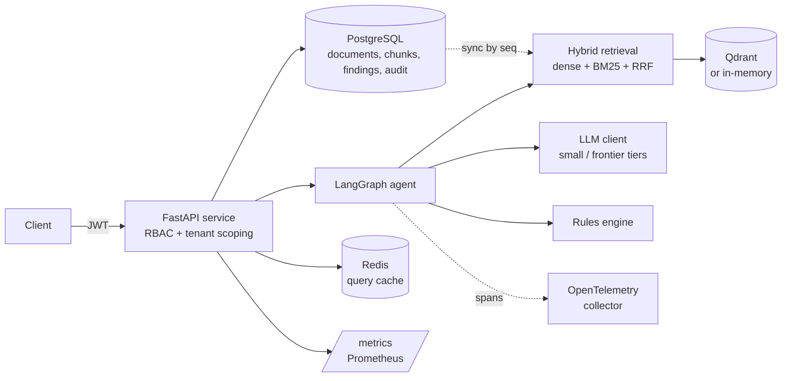

# Architecture

## Components



## Request flow: `POST /v1/query`

```mermaid
sequenceDiagram
    participant U as Client
    participant A as API
    participant C as Cache
    participant S as Index syncer
    participant G as Agent graph
    participant D as Database
    U->>A: question (+ document_id), Bearer JWT
    A->>A: verify JWT; org_id and role come from the token only
    A->>D: document belongs to org? (404 otherwise)
    A->>C: lookup (org, doc, normalised question)
    alt cache hit
        C-->>A: cached response
    else miss
        A->>S: pick up chunks uploaded via other replicas
        A->>G: invoke
        Note over G: retrieve → synthesize → validate_citations → score_risk
        G-->>A: answer, citations, findings, needs_review
        A->>D: persist findings (deduplicated) + audit rows
        A->>C: store
    end
    A-->>U: answer, grounded flag, findings, review_required
```

## Agent graph

`retrieve → synthesize → validate_citations → score_risk → (needs review?) → human_review → finalize`

| Node | What it does | Deterministic? |
|---|---|---|
| retrieve | Hybrid search scoped to the caller's org (and optionally one document) | yes |
| synthesize | LLM answers from retrieved chunks and cites `[chunk_id]`. Small-model tier | no (mock provider: yes) |
| validate_citations | Every cited chunk id must be in the retrieved set. Uncited or invalid ⇒ `grounded = false` | **yes, no LLM** |
| score_risk | Matches retrieved clauses against the rulebook; assigns confidence; decides review routing | yes |
| human_review | Marks the run as needing review; the API persists findings to the review queue | yes |

A finding goes to a human when its rule is `always_review` (indemnification, liability caps), when confidence
is below `REVIEW_CONFIDENCE_THRESHOLD` (0.85), or when an answer cited something that was not retrieved.
Reviewer decisions (approve / reject / edit) are written to an append-only `audit_log`.

## Multi-replica design

The database is the source of truth. Each replica's search index is a *derived* structure.

* `chunks.seq` is a monotonically increasing integer. Each replica remembers the highest `seq` it has indexed
  and, at most every `INDEX_SYNC_INTERVAL_SECONDS`, loads newer rows. A 500-row overlap is re-read because
  concurrent PostgreSQL transactions can commit slightly out of order; indexing is idempotent by `chunk_id`.
* Qdrant point ids are `uuid5(chunk_id)`, never per-process list positions, so replicas sharing a Qdrant server
  cannot overwrite one another's vectors.
* Redis is shared, so cache invalidation after an upload or a review decision reaches every replica. Without
  `REDIS_URL` each replica has a private cache and the app logs a warning in production.
* Schema creation retries and demo-user seeding is race-safe, because replicas start simultaneously.

## Security model

* `org_id` and `role` come only from the verified JWT. Request bodies cannot choose a tenant.
* Cross-tenant access returns 404 (not 403), so document ids are not an existence oracle.
* Roles: `viewer` (query, list) < `reviewer` (upload, review) < `admin`.
* Production refuses to start with the default or a short (<32 byte) JWT secret, and does not seed demo users.
* Retrieved text is passed to the LLM as delimited data with an instruction to treat it as untrusted.
  No tool in the graph takes an irreversible action; findings can only be resolved by a human.
* Containers run as a non-root user with a read-only root filesystem; Kubernetes pods drop all capabilities.
* CI authenticates to AWS with GitHub OIDC (no stored AWS keys); the trust policy is limited to `main` on one repo.

## Observability

* `/metrics` (Prometheus): query latency histogram, queries by cache hit/miss, findings by status and severity,
  LLM tokens by tier. A Grafana dashboard is provisioned in `infra/observability/`.
* OpenTelemetry: FastAPI is auto-instrumented and every agent node emits a span (`agent.retrieve`, …) when
  `OTLP_ENDPOINT` is set. Tested with an in-memory exporter.

## Trade-offs worth knowing

| Decision | Why | Cost |
|---|---|---|
| Rulebook matching by keyword coverage | Transparent, testable, no model needed for the review-routing logic | Weak on paraphrase; a production system would classify clauses with a model and calibrate confidence |
| Lexical embedder by default | Whole system runs and benchmarks offline, deterministically | No semantic matching ("law governs" ≠ "laws governed"); hybrid fusion adds little because both signals are lexical |
| `create_all` instead of migrations | Keeps the project small | No schema evolution story; Alembic is the next step |
| Document-scoped queries are the primary mode | Matches the reviewer workflow and is far more accurate than corpus-wide search with the lexical embedder | Corpus-wide questions need a real embedding model |
| Single-node Qdrant StatefulSet | Simple | Not HA |
